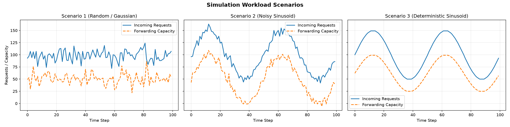
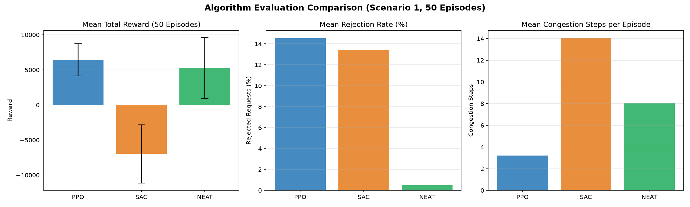
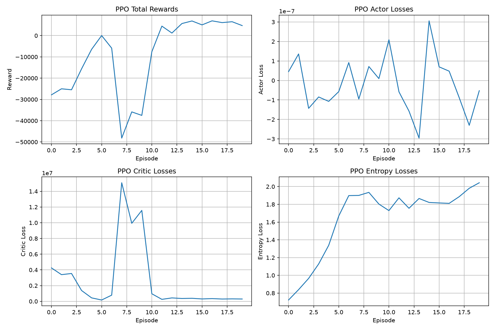
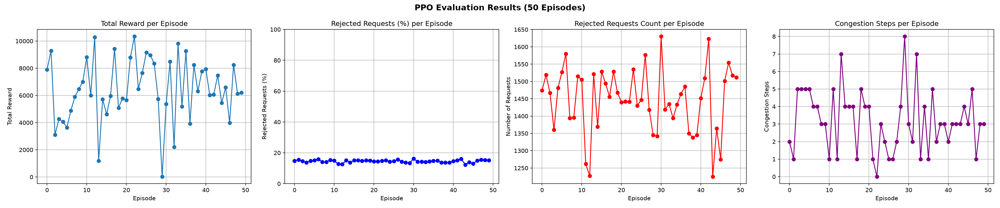
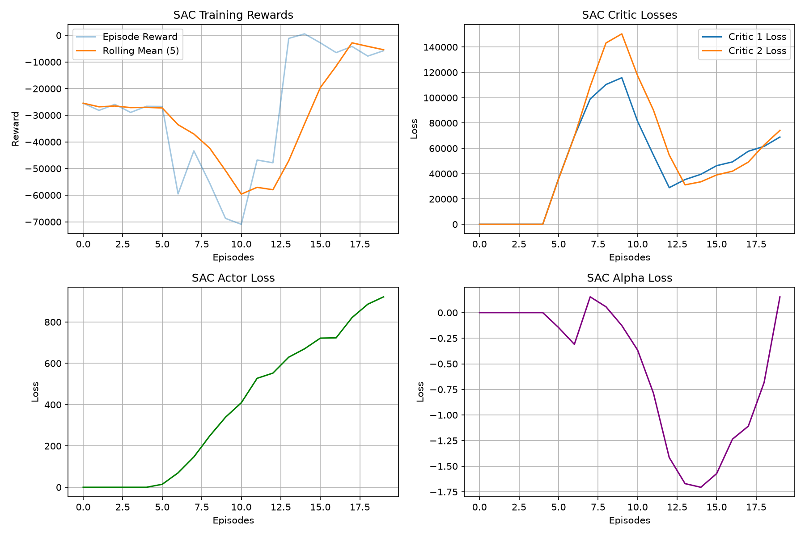
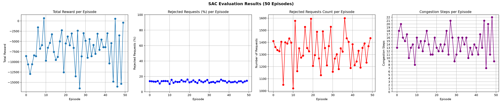
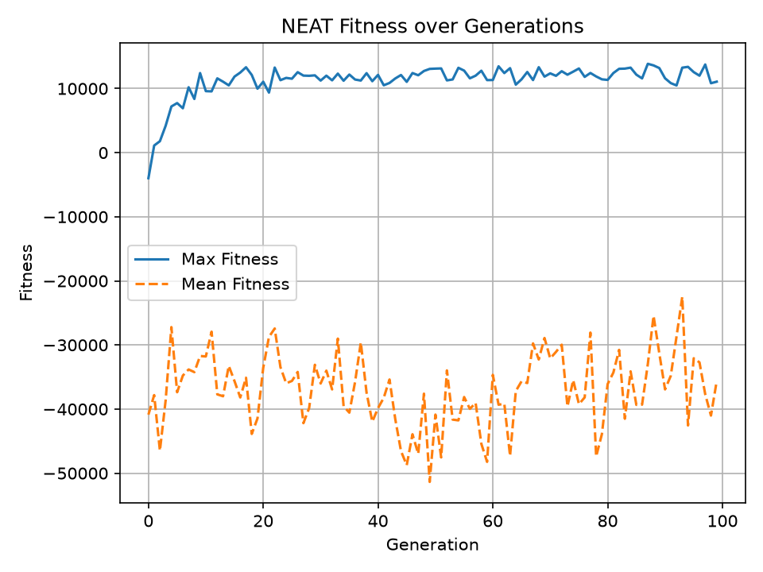
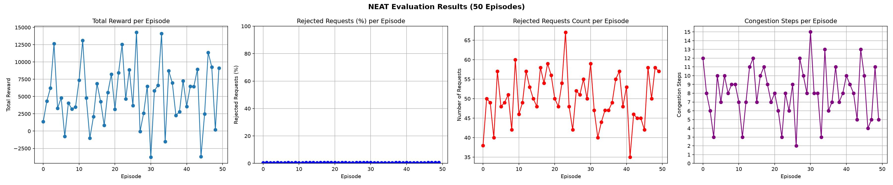

**Project completed at Sikkim Manipal Insitute of Technology in 2023. Publishing on Github for personal record.**

# EdgeFlow RL: Intelligent Workload Distribution for Decentralized Edge Computing

## Overview
**EdgeFlow RL** explores the use of deep reinforcement learning and neuroevolution to optimize workload management in a decentralized edge computing environment. The project implements two deep reinforcement learning algorithms, **SAC (Soft Actor-Critic)** and **PPO (Proximal Policy Optimization)**, alongside the evolutionary algorithm **NEAT (NeuroEvolution of Augmenting Topologies)** to learn effective policies for handling incoming traffic. Depending on current system conditions, the agent decides whether to process requests locally, offload them to neighboring edge nodes, or reject them. Note that the current simulation makes several simplifying assumptions compared to a real-world edge deployment.

In the simulated environment, the agent receives a time-varying stream of incoming requests. At every step, it determines how to split those requests across local execution, forwarding to another edge node, and rejection.

### Action Space
The `action space` is a three-dimensional continuous box, where each dimension specifies the proportion of incoming requests assigned to:
- **Local processing**
- **Forwarding** to a peer edge node
- **Rejection**

### Observation Space
The `observation space` captures four aspects of the system state:
- Number of incoming requests
- Remaining queue capacity
- Remaining forwarding capacity
- A congestion flag indicating whether the queue is currently congested

### Reward Function
The `reward function` evaluates both the agent's decisions and the resulting system state:
- **Highest reward** for processing requests locally
- **Lower positive reward** for forwarding requests to other edge nodes
- **Heavy penalties** for rejecting requests or triggering queue congestion

## Training and Evaluation Scenarios
Three distinct scenarios were created to test the algorithms under different operational conditions. These scenarios vary in how incoming requests are generated and how available forwarding capacity to other nodes changes over time:
- **Scenario 1**: Random Gaussian incoming requests and forwarding capacity
- **Scenario 2**: Noisy sinusoidal incoming requests and forwarding capacity
- **Scenario 3**: Deterministic sinusoidal incoming requests and forwarding capacity

Evaluating models trained in one scenario against the others provides insight into how well each approach adapts across different workloads and helps measure generalization versus overfitting.

## Key Results
Across all experiments, **PPO with standard hyperparameters trained on Scenario 2** achieved the highest reward scores and demonstrated the strongest generalization performance across unseen scenarios.

### Benchmark Comparison (Scenario 1, 50 Evaluation Episodes)

| Algorithm | Mean Reward | Max Reward | Mean Rejection Rate | Mean Congestion Steps |
| --- | ---: | ---: | ---: | ---: |
| **PPO** | 6424.08 | 10337.49 | 14.54% | 3.20 |
| **SAC** | -6986.44 | 658.38 | 13.40% | 14.04 |
| **NEAT** | 5257.68 | 14275.19 | 0.50% | 8.08 |

### PPO (Proximal Policy Optimization)
- **Training** (20 episodes, 100 steps/episode):

- **Evaluation** (50 episodes):

### SAC (Soft Actor-Critic)
- **Training** (20 episodes, 100 steps/episode):

- **Evaluation** (50 episodes):

### NEAT (NeuroEvolution of Augmenting Topologies)
- **Training** (100 generations, population size 100, best fitness `11071.63`):

- **Evaluation** (50 episodes):

